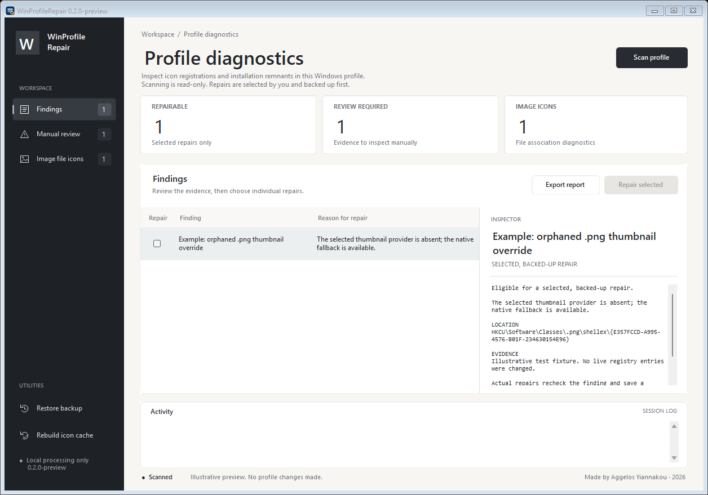

# WinProfileRepair

A small Windows desktop utility for inspecting and repairing a limited set of broken icon registrations and installation leftovers in the current user profile.

Made by Aggelos Yiannakou · 2026

**Current version: 0.2.0-preview.** The updated interface uses a quiet workspace, dark navigation, summary cards, and an evidence inspector. Scan and repair behavior and the backup format are unchanged from 0.1.0-preview.



The screenshot uses illustrative findings. The application starts with an empty workspace until you choose to scan.

**Preview:** the target platform is Windows 10/11 x64 with .NET Framework 4.8. This first version has been evaluated on one Windows machine. Broader compatibility needs independent testing. It is not a complete Windows health check or an uninstaller.

The application starts without scanning or changing anything. Scan results include the evidence for each finding. Repairs require an explicit selection, a review dialog, and a backup. Findings that need manual review are shown separately and cannot be selected for repair.

## Why this exists

The original investigation concerned grey taskbar icons for packaged Windows apps while their Start/search icons worked. The problem affected one Windows profile; other accounts on the same machine worked.

That profile had a PNG thumbnail-handler override pointing to an unregistered COM class left by a removed Google Drive installation. A direct shell thumbnail request failed with `0x80040154` (`REGDB_E_CLASSNOTREG`). The app image files and package registrations were present. Removing the broken override allowed Windows to use its registered image thumbnail provider; the same request then succeeded. A separate BMP override had the same defect.

There was one shared registration fault. Explorer, thumbnail, and application refreshes exposed the repaired icons at different times. Rebuilding the icon cache alone would not have corrected the missing COM registration.

This is one possible cause of grey icons. Missing files, damaged app packages, policies, permissions, graphics problems, and other shell failures need different diagnosis. WinProfileRepair does not assume that every grey icon has the original cause, and it does not identify Google Drive as responsible just because it finds a broken handler.

Microsoft documents [thumbnail-provider registration](https://learn.microsoft.com/en-us/windows/win32/shell/thumbnail-providers) and a separate [icon-cache procedure for blank application shortcuts](https://learn.microsoft.com/en-us/troubleshoot/windows-client/shell-experience/application-shortcuts-show-blank-icons).

## Scope

The scan checks direct current-user extension thumbnail overrides, current-user and machine uninstall records in both registry views, and `.lnk` files under the current user's Start Menu. A missing target is evidence to inspect; it does not automatically prove that an application should be uninstalled.

For thumbnail repairs, the selected override must have no child keys, its COM class must be absent from the checked classic and packaged COM registrations, and Windows' standard image fallback must point to an existing Windows DLL. Supported repair extensions are `.png`, `.bmp`, `.jpg`, `.jpeg`, `.gif`, `.tif`, and `.tiff`. Other extensions are review-only. Unknown thumbnail providers are never activated during scanning.

A generic uninstall record becomes eligible only when it is a current-user leaf record, is not marked as an MSI/system component, and its explicit installation folder, uninstaller, and application icon are all confirmed absent. There is also a narrow check for the obsolete Cursor 0.45.14 record alongside a newer intact Cursor installation. Broken shortcut cleanup covers direct missing executable targets and a narrow check for Anaconda prompt shortcuts invoking scripts from a wholly absent installation. Paths that are remote, inaccessible, or traverse reparse points do not establish safe absence.

Eligible repairs are limited to findings the repair engine can revalidate. The intended actions remove a broken override or stale record, or move a broken shortcut into a backup. They do not uninstall the related application or delete its profile data. Machine-wide records and findings with insufficient evidence remain review-only.

The separate icon-cache operation stops the current user's Explorer, removes eligible icon-cache files, and starts Explorer again. The desktop and taskbar disappear temporarily; open File Explorer windows may close. Windows regenerates the cache as icons are used. Save Explorer work before using this operation. The tool does not reboot Windows or reopen applications for you.

### Image file icons and thumbnails

The **Image file icons** tab checks the default application ProgID, icon reference, and resolved resource for common image formats. This is read-only: it does not reset default applications or rewrite protected UserChoice entries.

Explorer's small file-type icon and an image-content thumbnail are different things. An image application may supply the same document-with-picture icon for JPG, JPEG, and PNG. Matching icons alone do not prove corruption. A resource that resolves successfully also does not prove that an existing Explorer window is displaying a fresh cached image. Recheck the visible folder after restarting Windows if its icons still look stale.

The utility does not:

- Remove drivers, services, scheduled tasks, installed runtimes, app packages, or application data.
- Run vendor uninstallers or guess repair commands.
- Use `Win32_Product`, which can trigger Windows Installer consistency checks.
- Perform a generic registry cleanup or delete every missing file reference.
- Upload reports, collect telemetry, or require network access.

## Use

1. Run `WinProfileRepair.exe` as your normal Windows user. Do not choose **Run as administrator**. Profile repairs are intentionally blocked when the application is elevated.
2. Click **Scan profile**. This is read-only.
3. Use the sidebar to switch between findings, manual review, and image file icons. Select a finding to read its evidence and proposed action in the inspector. Check only the repairable items you want changed; all checkboxes start unchecked. Manual-review items require investigation outside this utility.
4. Click **Repair selected** and review the exact list. The engine rechecks the evidence before each change and refuses items that have changed or no longer qualify. An operation may stop before any changes or report individual items it could not repair.
5. Scan again to inspect the result. If icon registrations are corrected but icons remain stale, use **Rebuild icon cache** after reading its separate confirmation. Restart Windows yourself if needed, then check the icons again.

**Export scan report** saves a JSON file only where you choose. Reports may contain your user SID, user name, local paths, and installed application details. Review and redact a report before attaching it to a public issue. Do not upload backup folders or personal diagnostic captures.

## Backup and restore

Repair backups are stored under:

```text
%LOCALAPPDATA%\WinProfileRepair\Backups
```

Keep the complete operation folder, including its manifest and backed-up files. The result dialog and log show its location. A backup is created before the associated repair; a failed backup prevents that repair.

To undo a repair, click **Restore backup**, choose the operation folder, and review the confirmation. Restore validates that the backup belongs to the current profile and rejects unsafe paths or conflicting existing items. It will not overwrite an application that has since been reinstalled. Restore only backups you trust. Restoring a broken registration can bring the original problem back.

Icon-cache contents are disposable Windows-generated data and are not restored by the backup workflow. Windows builds new cache entries as needed.

If Windows fails while writing restored registry values, a partial key may remain. The tool reports this condition, keeps the backup, and refuses to overwrite the existing key on retry. Review that item manually before attempting another restore.

## Build and test

No external NuGet packages are required. The source uses C# 5, Windows Forms, and .NET Framework 4.8 APIs.

In PowerShell, from the repository root:

```powershell
.\build.ps1
.\tests\run-tests.ps1
```

The build creates `dist\WinProfileRepair.exe`, copies the release documentation into `dist`, and writes `dist\SHA256SUMS.txt`.

To build, test, and create the executable and source ZIP packages in one step:

```powershell
.\package.ps1
```

The Windows GitHub Actions workflow runs this same build/test/package process on pushes and pull requests. It uploads build artifacts; it does not automatically publish a release.

A read-only command-line report is also available. Choose a new filename; an existing file is not overwritten:

```powershell
.\dist\WinProfileRepair.exe --report .\scan-report.json
```

Read the build and test scripts before running them. Tests are designed to exercise temporary fixtures rather than repair the host profile. Scan-only validation should be used first on a new Windows installation. An automated test pass does not establish that every repair is safe on every Windows configuration.

## Releases and contributing

The project is published at [aggelosy/WinProfileRepair](https://github.com/aggelosy/WinProfileRepair). Download the current preview from [v0.2.0-preview](https://github.com/aggelosy/WinProfileRepair/releases/tag/v0.2.0-preview), or browse [all releases](https://github.com/aggelosy/WinProfileRepair/releases).

Download `WinProfileRepair-v0.2.0-preview-win-x64.zip`, extract it, and run `WinProfileRepair.exe` as your normal Windows user. The release also includes a separate source ZIP and `SHA256SUMS.txt` with SHA-256 checksums for the executable and both ZIP packages. The corresponding source is tagged `v0.2.0-preview` so you can review or build it yourself. Keep personal diagnostics, registry exports, logs, and backup data private.

The preview executable is unsigned. Windows or SmartScreen may display a warning. Review the source, build it yourself if preferred, and follow your organization's software policy. Code signing and wider Windows testing are release improvements, not claims made by this preview.

For a bug report, include the Windows version, application version, expected behavior, observed behavior, and redacted finding evidence. Avoid credentials, account identifiers, and entire registry exports. See [SECURITY.md](SECURITY.md) for security reports.

Licensed under the [MIT License](LICENSE).
